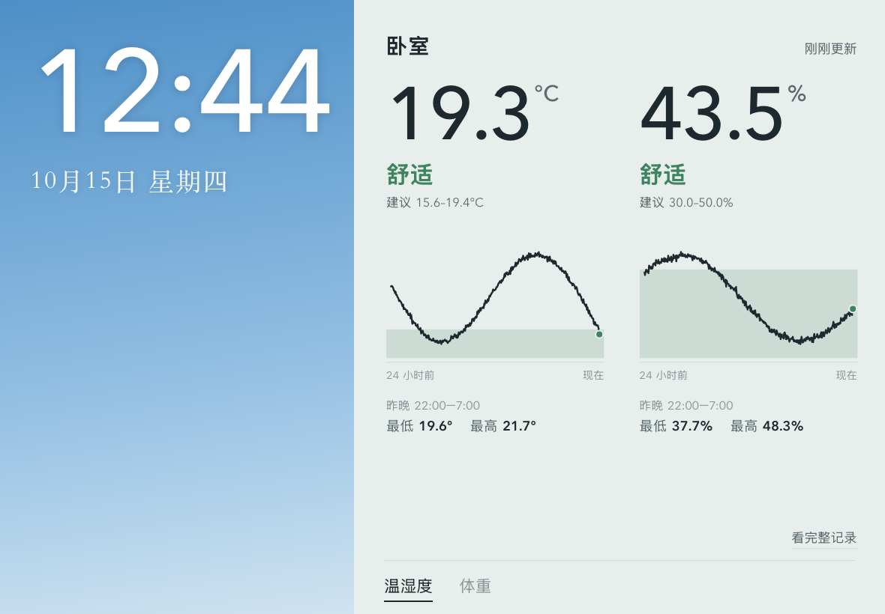
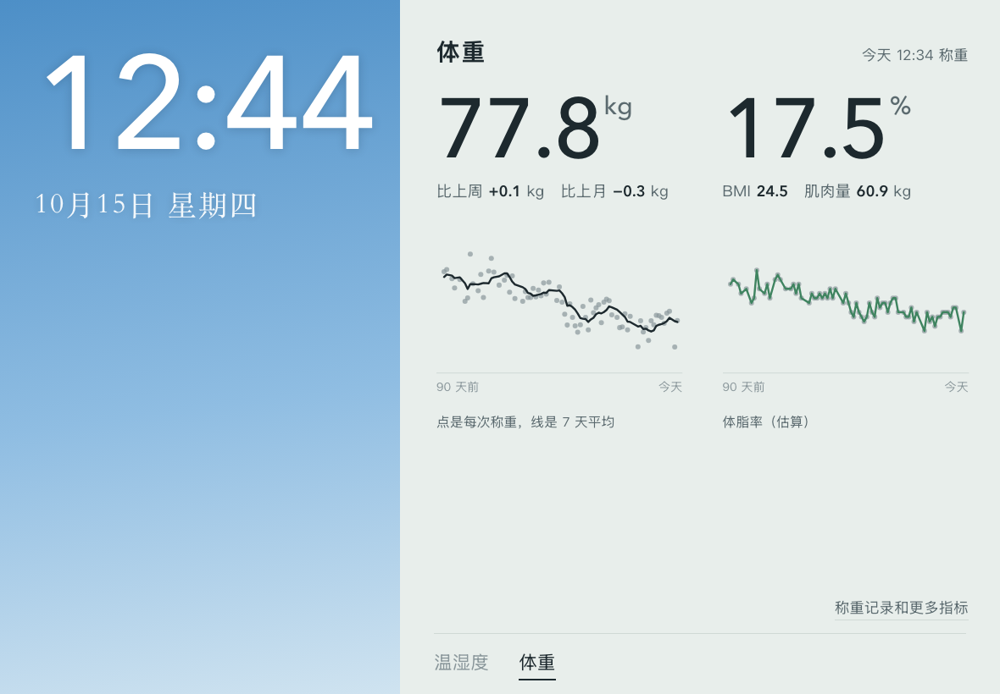
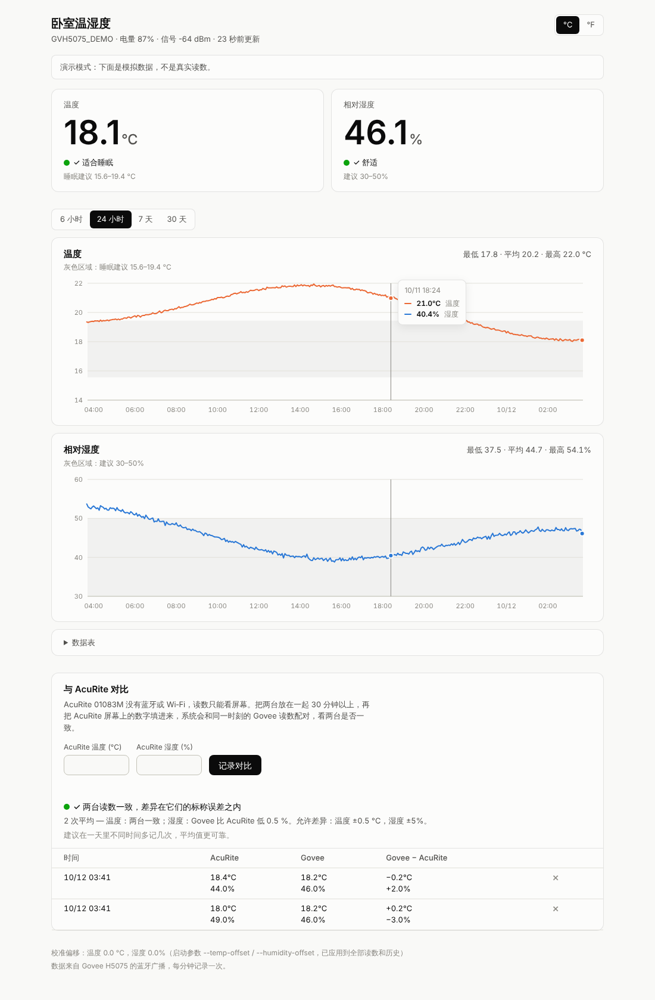

# 家庭看板

放在家里一块常亮的 iPad 上：左边是时钟，右边按 tab 显示**卧室温湿度**和**体重、体脂**。数据由家里一台带蓝牙的电脑直接从传感器和体重秤读取，存在这台电脑上，不经过任何云端。





## 家里这两台温度计能不能读到数据？

| 设备 | 能否自动读取 | 原因 |
|---|---|---|
| **Govee H5075**（[B07Y36FWTT](https://www.amazon.com/dp/B07Y36FWTT)） | ✅ 可以 | 它大约每 2 秒用蓝牙广播一次温度、湿度和电量，任何带蓝牙的电脑都能直接收到，**不需要配对，不需要 Govee 账号或云端**。 |
| **AcuRite 01083M**（[B01HDW58GS](https://www.amazon.com/dp/B01HDW58GS)） | ❌ 不行 | 它只有一块液晶屏，没有蓝牙、Wi‑Fi 或任何数据接口。看板里可以**手动填写**它的读数，用来和 Govee 对比准确度。 |

所以看板的数据来自 Govee；AcuRite 留在旁边当“参照物”。

## 需要什么

- 一台**带蓝牙、放在卧室附近**的电脑，一直开着：树莓派（3B+/4/5/Zero 2 W 都行）、Mac 或 Windows/Linux 电脑。蓝牙穿墙后距离会缩短，最好在 10 米以内。
- Python 3.10 或更新版本。
- 看板在局域网里提供网页，家里任何手机、平板、电脑的浏览器都能打开；按横放的 iPad 设计，手机竖屏也能看。
- 想记录体重的话，一台 Etekcity ESF-551 体重秤（见下面的[体重和体脂](#体重和体脂etekcity-esf-551)）。

## 快速开始

```bash
git clone <本仓库> && cd <仓库目录>
python3 -m venv .venv && source .venv/bin/activate   # Windows: .venv\Scripts\activate
pip install -r requirements.txt

# 1. 不接传感器，先用模拟数据看看效果
python -m home_dashboard --demo
#    打开 http://localhost:8000（模拟数据里也有体重 tab）

# 2. 找到你的 Govee（列出附近所有 H5075，以及它们当前的读数）
python -m home_dashboard --scan

# 3. 正式运行
python -m home_dashboard
#    手机上打开 http://<这台电脑的局域网 IP>:8000
```

不加 `--device` 时，程序会锁定**第一台**收到广播的 H5075。如果邻居或家里其他房间也有 Govee，用 `--scan` 看到的名字或地址指定：

```bash
python -m home_dashboard --device GVH5075_1A2B   # 名字的一部分也行，例如 --device 1A2B
```

> **macOS**：从终端直接运行可能会因为蓝牙权限被系统杀掉（`Abort trap: 6`），请看下面的[在 Mac 上常驻](#在-mac-上常驻)。macOS 不显示蓝牙 MAC 地址，`--scan` 里看到的是一串 UUID，用名字指定更方便。

## 看板上有什么

左边的时钟背景随一天的时间变色（清晨、白天、傍晚、夜里），以后可以换成家里的照片。21:30 到 5:30 整个页面自动变暗，免得卧室里太亮；内容每分钟挪动几个像素，防止常亮的屏幕烧屏。每天凌晨 4 点页面自动刷新一次，以便用上新版本。

**温湿度 tab**

- **当前温度和湿度**，以及是否在建议范围内（温度默认 15.6–19.4 °C / 60–67 °F，湿度默认 30–50%，依据见下方“参考资料”）。
- **过去 24 小时曲线**，浅色带是建议范围；以及昨晚 22:00–7:00 的最低、最高值。
- 超过 5 分钟没收到传感器信号、或者连不上服务时，标题右边会直接说明。
- 点“看完整记录”进入原来的完整页面（下图）：6 小时 / 24 小时 / 7 天 / 30 天曲线、数据表、°C / °F 切换，以及**与 AcuRite 对比**：把 AcuRite 屏幕上的数字填进去，自动和同一时刻的 Govee 读数配对，算出两台平均差多少、是否在两台的标称误差之内。



**体重 tab**（配置了体重秤才会出现）

- 最新体重、和上周 / 上月比的变化（都用 7 天平均来比，避免每天的正常波动干扰）、90 天曲线（点是每次称重，线是 7 天平均）。
- 体脂率、BMI、肌肉量和 90 天体脂曲线。“称重记录和更多指标”里有最近的称重列表（可以删掉拿着东西称、别人踩上去之类的错误记录，点两下确认）和全部指标。

网址后面加 `#weight` 或 `#climate` 会直接打开对应的 tab。

## 准不准？怎么校准

简短结论：两台都是比较准的型号。Govee H5075 标称 ±0.3 °C、±3% RH，AcuRite 01083M 标称 ±0.2 °C（±0.5 °F）、±2% RH。但这是新机在典型条件下的指标，单台会有偏差，湿度传感器用久了也会漂移；放的位置不对（晒太阳、靠近空调出风口或电器）带来的误差往往比传感器本身更大。

完整的检验步骤见 **[docs/accuracy.md](docs/accuracy.md)**：并排对比 → 盐水测试（75% 湿度基准）→ 把偏差写进看板。

校准偏移在启动时设置，会同时修正历史数据（数据库里存的是原始读数）：

```bash
python -m home_dashboard --temp-offset -0.3 --humidity-offset 2.5
```

> Govee App 里也能设置校准，但据用户反馈那只改 App 里的显示，不会改变蓝牙广播出来的数值，所以要在这里另外设置。

## 体重和体脂（Etekcity ESF-551）

支持 **Etekcity ESF-551**（[B095YJW56C](https://www.amazon.com/dp/B095YJW56C)），协议由开源库 [etekcity-esf551-ble](https://github.com/ronnnnnnnnnnnnn/etekcity_esf551_ble)（MIT）实现。不需要 VeSync App，也不需要账号：

1. 秤平时在睡眠。站上去后它醒来、开始广播，电脑发现后连上去（实测约 3 秒），读数稳定时秤把体重和阻抗发过来，程序存一条记录。秤屏幕上显示什么单位都不影响，程序收到的始终是 kg。
2. 下秤约 30 秒后秤进入睡眠，连接自动断开，等下次再称。
3. 和温湿度计不同，体重要**建立连接**才能读，所以距离更重要。实测隔一道墙（浴室）信号 -62 dBm，连接正常。
4. 秤同一时间通常只能连一台设备。如果手机上的 VeSync App 开着并先连上了，那一次称重电脑就收不到。

找到秤的地址（站上秤，让它醒着）：

```bash
python -m home_dashboard --scan-scale --scan-seconds 30
```

然后带上 `--scan-scale` 找到的地址和你的身高、年龄、性别运行（下面的数字只是示例）：

```bash
python -m home_dashboard --scale AA:BB:CC:DD:EE:FF --height-cm 175 --age 30 --sex male
```

- 只给 `--scale` 时只显示体重；加上 `--height-cm` 会显示 BMI；三项都给才有体脂等估算值。**年龄每年要手动改一次。**
- 数据库里只存秤测到的体重和阻抗，体脂等数值在显示时才算。所以改了身高或年龄之后，历史记录也会一起按新值重算。
- 体脂率、肌肉量、内脏脂肪等都是**估算值**，算法和 VeSync App 给 ESF-551 用的一致（库作者对照过）。看公式会发现，体脂率主要由 BMI 和年龄决定，阻抗的影响只有 1 个百分点左右，所以适合看趋势，不是医学测量。光脚站上去才测得到阻抗。佩戴心脏起搏器等植入设备的人不要使用测阻抗的功能。
- 身高、年龄这些个人信息只写在运行参数里（Mac 上是本机的 LaunchAgent 配置），不要提交到仓库。

### 用 DEXA 校准体脂

秤的公式只看 BMI 和年龄（阻抗影响很小），看不出一个人肌肉偏多还是偏少，所以体脂可能差很多。如果做过 DEXA（BodySpec 等），可以用它来校准：

1. 用秤的公式，按 DEXA 当天的体重算一个体脂估算值。最简单的办法是 DEXA 当天也在秤上称一次，看看那时看板上显示多少（偏移设为 0 的时候）。
2. 偏移 = DEXA 体脂率 − 秤的估算值，用 `--body-fat-offset` 传进去，例如 `--body-fat-offset 8.5`。

这个偏移会作用到所有从体脂推出来的指标上：去脂体重、肌肉量、体水分、基础代谢等。实测同一个人三次 DEXA（跨两年多）算出来的偏移，彼此只差 0.1 个百分点，说明它是稳定的系统偏差，校准一次就够用；每次做完新的 DEXA 再核对一下就行。要注意的是，公式里体脂随体重变化的斜率仍是秤原来的，大约 0.5 个百分点每公斤；而纯脂肪的增减实际约 1 个百分点每公斤。所以校准管得住绝对值，管不住变化幅度：减脂时看板上的下降会比 DEXA 量到的小一些。

## 所有参数

| 参数 | 默认值 | 说明 |
|---|---|---|
| `--demo` | | 用模拟数据运行，不需要蓝牙 |
| `--scan` | | 列出附近的 Govee H5075 后退出 |
| `--device` | 第一台收到的 | 传感器地址，或名字的一部分 |
| `--db` | `climate.db` | SQLite 数据库文件 |
| `--host` | `0.0.0.0` | 监听地址；默认整个局域网可访问，只想本机访问用 `127.0.0.1` |
| `--port` | `8000` | 网页端口 |
| `--interval` | `60` | 每隔多少秒存一条数据 |
| `--temp-offset` | `0` | 温度校准偏移（°C） |
| `--humidity-offset` | `0` | 湿度校准偏移（%RH） |
| `--temp-range` | `15.56,19.44` | 建议温度范围（°C），例如 `--temp-range 18,22` |
| `--humidity-range` | `30,50` | 建议湿度范围（%RH） |
| `--scan-scale` | | 列出附近的 Etekcity 体重秤后退出（站上秤让它醒着） |
| `--scan-seconds` | `15` | `--scan` / `--scan-scale` 扫描多久（秒） |
| `--scale` | | 体重秤的蓝牙地址；给了才有体重 tab |
| `--height-cm` | | 身高（厘米），用于 BMI 和体脂 |
| `--age` | | 年龄（岁），用于体脂 |
| `--sex` | | `male` 或 `female`，用于体脂 |
| `--body-fat-offset` | `0` | 体脂校准偏移（百分点），见“用 DEXA 校准体脂” |

看板没有登录功能，局域网里的人都能看到温湿度、体重和体脂，也能添加或删除记录。不要把端口映射到公网。

## 在树莓派上开机自启

`/etc/systemd/system/bedroom-climate.service`（把路径和用户名换成你的）：

```ini
[Unit]
Description=Bedroom climate dashboard
After=bluetooth.target network-online.target
Wants=bluetooth.target

[Service]
User=pi
WorkingDirectory=/home/pi/bedroom-climate
ExecStart=/home/pi/bedroom-climate/.venv/bin/python -m home_dashboard --db /home/pi/bedroom-climate/climate.db
Restart=always
RestartSec=10

[Install]
WantedBy=multi-user.target
```

```bash
sudo systemctl enable --now bedroom-climate
journalctl -u bedroom-climate -f   # 查看日志
```

## 在 Mac 上常驻

已在 Mac mini（Apple 芯片，macOS 26.5，bleak 3.0.2）上实测。macOS 上有几处坑，`mac/step.sh` 都处理好了。每一步的输出也会存到 `mac/logs/<步骤>.log`：

```bash
mac/step.sh env                      # 找 Python ≥ 3.10，建 .venv，安装依赖，跑测试
mac/step.sh app                      # 编译 mac/build/BedroomClimate.app（需要 Xcode 或命令行工具）
mac/step.sh scan                     # 通过这个 App 扫描附近的 H5075，显示原始广播数据
mac/step.sh scan-scale               # 扫描附近的 Etekcity 体重秤（运行时站上秤）
mac/step.sh agent-install 2186 app   # 装成 LaunchAgent：登录后自动运行，退出后自动重启
mac/step.sh agent-status             # 是否在运行、最新读数、日志末尾
mac/step.sh agent-restart            # launchctl kickstart -k 重启，并检查能否恢复
mac/step.sh info                     # 局域网链接、防火墙和睡眠设置（只读）
mac/step.sh agent-uninstall          # 停止并删除 LaunchAgent
```

`2186` 换成你的传感器名字的一部分（见 `scan` 的输出）。要显示体重 tab，在 `app` 后面接上传给程序的参数，它们只写进本机的 `~/Library/LaunchAgents/local.bedroom-climate.plist`：

```bash
mac/step.sh agent-install 2186 app --scale AA:BB:CC:DD:EE:FF --height-cm 175 --age 30 --sex male
```

温湿度和体重都存在 `~/Library/Application Support/bedroom-climate/climate.db`，日志在 `~/Library/Logs/bedroom-climate.log`。每存一条读数，日志里就记一行 `Saved ...`，一天大约 150 KB，不会自动轮转，太大了可以直接清空：`: > ~/Library/Logs/bedroom-climate.log`。

### 踩过的坑

1. **在 Warp 里直接运行 `python -m home_dashboard`，进程会被系统杀掉（`Abort trap: 6`）。** 一个进程想用蓝牙，macOS 要求对它“负责”的那个 App 在 Info.plist 里写有 `NSBluetoothAlwaysUsageDescription`，并且用户允许过；否则直接 SIGABRT。从终端启动时，负责的 App 是终端本身，而 Warp 没有这一项（iTerm2 有）。在 Warp 里直接执行 `.app` 里面的可执行文件也不行，负责的 App 仍然是 Warp。解决办法是用 `mac/launcher.c` 和 `mac/Info.plist` 编一个带蓝牙用途说明的小 App（ad-hoc 签名），再由它启动 python。前台运行时用 `open -W -n -g -a BedroomClimate.app --args ...`（`step.sh scan` 就是这样做的），后台由 launchd 直接启动这个 App。系统如果弹出蓝牙权限请求，点“允许”。
2. **`--scan` 明明有信号，却显示 “No Govee H5075 found”。** H5075 在 Govee 自己的数据（公司 ID `0xEC88`）之外，另一个广播包里还带一段 Apple iBeacon（UUID 是 ASCII 的 `INTELLI_ROCKS_HW`）。CoreBluetooth 会把这两段厂商数据拼成一个值交给 bleak，程序收到的就是 31 字节，而不是 6 字节，旧的解析器会把它当成无效数据。现在 `govee.py` 会先去掉末尾的 iBeacon 部分；`tests/test_govee.py` 里收了一条真机数据。
3. **后台服务只在启动时收到一条读数，之后就不更新了。** CoreBluetooth 默认会过滤重复广播：同一次扫描里，每台设备只报告一次，之后只有广播内容变了（温度或湿度变化 0.1）才会再报告。bleak 3.0.2 没有打开 `CBCentralManagerScanOptionAllowDuplicatesKey`，所以卧室温度稳定时 Mac 什么也收不到，“最后更新”越来越旧，5 分钟后看板就提示没信号了；旧版本还会把同一条读数每分钟重复存一遍。现在分两层处理：
   - 每次开始扫描后，再用 `AllowDuplicates` 选项调用一次 `scanForPeripheralsWithServices:options:`，让 CoreBluetooth 上报每一条广播。bleak 没有提供这个参数，所以要通过它的内部对象 `scanner._backend._manager.central_manager` 去调；以后 bleak 改了内部结构，就自动退回到下面那一层。
   - 连续 20 秒没有新广播，就停止扫描再重新开始，新的一次扫描只要收得到，就会再报告一次传感器。实测只靠这一层时，重新扫描后常常要等一两轮才再次收到广播，存下的读数有 40–56 秒旧，离漏掉一分钟只差一点，所以两层都留着。整个运行期间只用一个 `BleakScanner` 反复 start/stop，因为在 macOS 上每新建一个 scanner 就会新建一个 CBCentralManager。

   同一条广播不会重复存储。Linux 上广播会源源不断地进来，不会触发重新扫描。
4. **隔着墙时，Mac 只能收到传感器很少一部分广播。** 传感器放在卧室（-67 到 -83 dBm），用一个允许重复上报的扫描诊断了 90 秒：这段时间 CoreBluetooth 每 10 秒能上报附近设备 160–430 次，这台 H5075 却只被听到 1 次，同一时间后台服务也没收到。可见问题出在接收这一层（距离、墙，或者传感器本身发得不够勤），既不是软件在过滤，也不是解析出了错。实测 12 分钟里有 10 分钟存到了新数据，偶尔会有一两分钟没有。没收到新广播的那一分钟不会写入数据库，日志里会记一条 `WARNING No new broadcast ...`，曲线上就是少一个点。想要更密的数据，就缩短传感器和 Mac 之间的距离，或者减少中间的墙。
5. **LaunchAgent 要在你登录以后才会运行。** Mac 重启后，要先登录一次才会开始采集。
6. **体重秤要用 MAC 地址来认。** macOS 默认把蓝牙设备的 MAC 地址藏起来，只给一串 UUID；体重秤的库靠 MAC 地址识别秤，所以扫描时打开了 bleak 的 `use_bdaddr` 选项（走的是 macOS 未公开的接口）。秤的扫描也同样打开了“上报每一条广播”，免得 CoreBluetooth 只报一次，秤第二天醒来时却发现不了。

## 在 iPad 上常亮显示

1. 在 iPad 的 Safari 里打开 `http://<Mac 的名字>.local:8000`（Mac 的名字见 `mac/step.sh info`），点“分享”→“添加到主屏幕”。从主屏幕打开时是全屏的，没有地址栏。
2. “设置”→“显示与亮度”→“自动锁定”改成“永不”，接上电源。
3. 想让别人点不出去，可以打开“设置”→“辅助功能”→“引导式访问”。

用 `.local` 名字而不是 IP 地址：路由器会重新分配 IP，名字不会变。

## 已经在用 Home Assistant？

Home Assistant 自带 [Govee Bluetooth 集成](https://www.home-assistant.io/integrations/govee_ble/)，能直接识别 H5075，这种情况下不必再运行本程序。本程序适合不想装 Home Assistant、只要一个卧室看板的情况。

## 开发

```bash
python -m unittest        # 测试不需要蓝牙
```

代码结构：每个 tab 是一个模块，包括后台任务、JSON 接口（`/api/<模块>/...`）和一个前端视图。加一个新 tab，就是在 `home_dashboard/modules/` 下新建一个模块，在 `__main__.py` 里注册，再写对应的 `static/<模块>.js`。

- `home_dashboard/__main__.py`：命令行参数，启动网页服务和各模块的后台任务
- `home_dashboard/server.py`：网页、静态文件，以及把 `/api/<模块>/...` 分发给各模块；`/api/home` 列出启用的 tab
- `home_dashboard/ble.py`：蓝牙公用函数（让 CoreBluetooth 上报每一条广播）
- `home_dashboard/modules/climate/`：温湿度。`govee.py` 解析 H5075 广播，`collector.py` 扫描并每分钟存一条，`store.py` 是 SQLite 存储，`api.py` 是接口（`/api/climate/latest`、`history?hours=24`、`checks`、`config`）
- `home_dashboard/modules/weight/`：体重。`collector.py` 连接体重秤并存每次称重，`store.py` 是 SQLite 存储，`api.py` 是接口（`/api/weight/latest`、`history?days=90`、`DELETE readings/<id>`），会算 7 天平均和体脂
- `home_dashboard/static/`：`index.html`、`shell.*`（外壳：时钟、tab 栏、共用布局）、`climate.*`、`weight.*`，以及 `climate-full.html`（完整记录页）。无外部依赖，离线可用

## 参考资料

- H5075 广播格式：[Bluetooth-Devices/govee-ble](https://github.com/Bluetooth-Devices/govee-ble)（Home Assistant 使用的解析库）。本项目的解析结果与它在 20 万组随机数据上逐一核对一致。
- Govee H5075 精度：[Govee 产品页](https://eu.govee.com/products/govee-bluetooth-hygrometer-thermometer-h5075)
- AcuRite 01083M 精度：[AcuRite: What are the Accuracy Standards?](https://support.acurite.com/hc/en-us/articles/360007659854-What-are-the-Accuracy-Standards)
- 睡眠温度和湿度建议：[Sleep Foundation: Humidity and Sleep](https://www.sleepfoundation.org/bedroom-environment/humidity-and-sleep)
- Etekcity ESF-551 协议和体脂算法：[ronnnnnnnnnnnnn/etekcity_esf551_ble](https://github.com/ronnnnnnnnnnnnn/etekcity_esf551_ble)
