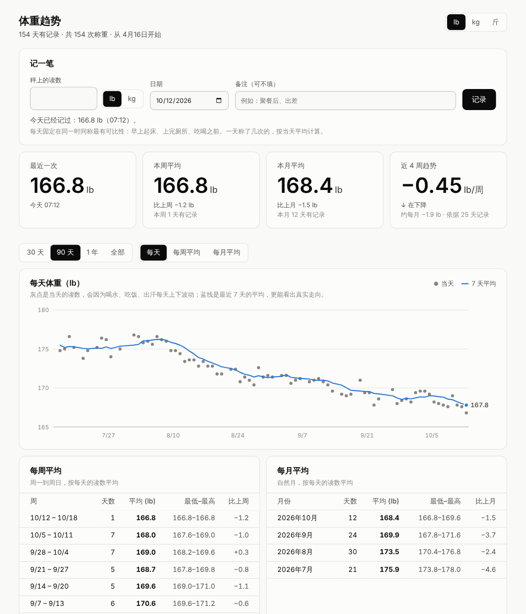

# 体重看板

每天称完把数字记下来，自动算出每周平均、每月平均和体重趋势。手机、电脑的浏览器都能打开。



## 家里这台秤能连电脑吗？

| 设备 | 能否自动读取 | 原因 |
|---|---|---|
| **Greater Goods 玻璃体重秤**（[B077H86415](https://www.amazon.com/dp/B077H86415)） | ❌ 不行 | 它只有一块液晶屏，用 4 节 AAA 电池，没有蓝牙、Wi‑Fi 或 USB，也不保存历史读数。人一下秤数字就消失了，电脑没有办法读到。 |

所以这个看板靠**手动记录**：站上秤，把屏幕上的数字填进手机里的看板，大约 10 秒。剩下的平均、对比和趋势都由看板来算。

如果以后想全自动：

- **换一台联网的秤。** 带 App 的智能秤（包括 Greater Goods 自己的 Weight Gurus 系列）大多能从 App 导出 CSV，导出后可以直接导入这里（见下方“导入以前的记录”）。
- **用会广播蓝牙数据的秤。** 有的秤（例如小米体脂秤 2）像卧室那台 Govee 一样会广播读数，电脑可以直接收到。本程序目前不支持，需要的话可以再加。
- 不推荐拆开这台秤加装电路（在称重传感器上接 HX711 + ESP32），也不推荐拍照识别：它是隐藏式液晶屏，反光强，识别不可靠，还不如手输快。

## 需要什么

- 一台**一直开着**的电脑，Python 3.10 或更新版本，不需要安装任何第三方库。已经在跑卧室温湿度看板的树莓派就可以，两个程序可以同时运行（端口不同）。
- 手机和这台电脑连同一个 Wi‑Fi。

## 快速开始

```bash
cd <仓库目录>

# 1. 先用模拟数据看看效果（不会保存任何东西）
python -m weight_tracker --demo
#    打开 http://localhost:8001

# 2. 正式运行，数据存在 weight.db
python -m weight_tracker
#    手机上打开 http://<这台电脑的局域网 IP>:8001
```

建议在手机浏览器里把这个网址**添加到主屏幕**（iPhone：Safari 分享按钮 →“添加到主屏幕”），以后点图标就能记。

## 看板上有什么

- **记一笔**：秤上的读数，单位选 lb 或 kg（和秤上显示的一致），日期默认今天，也可以补记以前的。和上一次相差 5% 以上会先提醒确认，防止少输一位数或单位选错。
- **最近一次**、**本周平均**（比上周）、**本月平均**（比上月）、**近 4 周趋势**（平均每周变化多少）。
- **曲线**：可切换“每天”（灰点是当天读数，蓝线是 7 天平均）、“每周平均”、“每月平均”；时间范围 30 天 / 90 天 / 1 年 / 全部。鼠标悬停或手指按住可查看每个点的数值。
- **每周平均表**和**每月平均表**：有记录的天数、平均、最低–最高、比上周 / 比上月。
- **每一条记录**：输错了可以删掉重记。
- 右上角切换显示单位 **lb / kg / 斤**。只影响显示，记录按秤上的原样保存，来回切换不会有误差。
- 深色模式、手机布局。

## 平均和趋势是怎么算的

单日读数会因为喝水、吃饭、出汗、吃咸了而上下波动，这种波动常常比一周里真实的变化还大。所以看板把重点放在平均值和趋势上：

| 指标 | 算法 |
|---|---|
| 当天 | 当天所有读数的平均。一天称三次也只算一天，不会让那天的分量变大。 |
| 7 天平均 | 截至当天、最近 7 个日历天里有记录的那些天的平均。 |
| 每周平均 | 周一到周日，把每天的值再平均。表里会显示有记录的天数，只有一两天的周，平均值参考价值有限。 |
| 每月平均 | 自然月，算法同上。 |
| 比上周 / 比上月 | 和紧挨着的上一周 / 上一个月比；上一周（月）没有记录就不比。 |
| 近 4 周趋势 | 用最近 28 天每天的值拟合一条直线（最小二乘法），斜率换算成每周变化。至少要有 4 天记录、跨度超过一周才显示；每周变化不到 0.1 kg（约 0.2 lb）时显示“基本持平”。这 28 天以最后一次记录为终点，中间停记一段时间趋势也不会消失，但会注明“截至某天”。 |

想要数字最有可比性：每天同一时间称，最好是早上起床、上完厕所、吃喝之前；秤放在硬而平的地面上（不要放地毯上），每次放在同一个位置。

## 导入以前的记录 / 导出

在看板最下方选一个 CSV 文件就能导入，也可以用命令行：

```bash
python -m weight_tracker --import 旧记录.csv --unit kg   # --unit：文件里没写单位时按什么算
```

能识别的内容：

- **列**：按表头找。日期列的表头里有 `date` / `日期` / `time` / `时间`，体重列的表头里有 `weight` / `体重` / `body mass`（会避开“体脂”“肌肉”“目标体重”这类列）。没有表头的文件按“日期,体重[,单位]”的顺序读。
- **单位**：可以写在表头里（`Weight (kg)`、`体重(斤)`）、单独一列 `unit`，或者跟在数字后面（`165.4 lb`、`75.3kg`）；都没有就用你选的默认单位。斤会自动换算成 kg。
- **日期**：`2026-10-12`、`2026/10/12`、`2026年10月12日`、`10/12/2026`（斜杠日期按美国习惯读作**月/日/年**），后面可以带时间。
- **编码**：Excel 存的 CSV，不管是 UTF‑8 还是中文 Windows 默认的 GBK，都能读。
- **重复记录**（同一天、同一时间、同样体重）会自动跳过，同一个文件导入两次也不会重复。有问题的行会列出行号和原因，其余照常导入。

**导出**：点“导出全部记录 (CSV)”。导出的文件用 Excel 直接打开，中文不会乱码，也能原样导回来，可以当备份用。直接复制 `weight.db` 文件也是一种备份。

## 不打开网页，直接看平均

```bash
python -m weight_tracker --report --unit kg
```

```
每周平均（kg，周一至周日）
               天数    平均    最低    最高  比上周
2026-10-12 起      1    75.7    75.7    75.7    -0.5
2026-10-05 起      7    76.2    76.0    76.7    -0.5
...
近 4 周趋势：每周 -0.20 kg（2026-09-15 至 2026-10-12，25 天有记录）
```

## 所有参数

| 参数 | 默认值 | 说明 |
|---|---|---|
| `--demo` | | 用半年的模拟数据运行，什么都不保存 |
| `--db` | `weight.db` | SQLite 数据库文件 |
| `--host` | `0.0.0.0` | 监听地址；默认整个局域网可访问，只想本机访问用 `127.0.0.1` |
| `--port` | `8001` | 网页端口（卧室温湿度看板默认用 8000，两个不冲突） |
| `--import FILE` | | 导入 CSV 后退出 |
| `--report` | | 在终端打印每周 / 每月平均和趋势后退出 |
| `--unit` | `lb` | `--report` 用的单位；`--import` 时文件里没写单位就按这个 |

看板没有登录功能，局域网里的人都能看到并添加、删除记录。不要把端口映射到公网。

## 在树莓派上开机自启

`/etc/systemd/system/weight-tracker.service`（把路径和用户名换成你的）：

```ini
[Unit]
Description=Weight dashboard
After=network-online.target

[Service]
User=pi
WorkingDirectory=/home/pi/bedroom-climate
ExecStart=/usr/bin/python3 -m weight_tracker --db /home/pi/bedroom-climate/weight.db
Restart=always
RestartSec=10

[Install]
WantedBy=multi-user.target
```

```bash
sudo systemctl enable --now weight-tracker
```

## 开发

```bash
python -m unittest        # 全部测试
```

代码结构：

- `weight_tracker/store.py`：SQLite 存储，读数按秤上原样（数字 + 单位）保存
- `weight_tracker/stats.py`：每天的值、7 天平均、每周 / 每月平均、趋势
- `weight_tracker/csvio.py`：CSV 导入（自动识别列、单位、日期格式）和导出
- `weight_tracker/server.py`：网页和 JSON 接口（`/api/summary`、`/api/entries`、`/api/import`、`/api/export.csv`）
- `weight_tracker/static/index.html`：看板页面（无外部依赖，离线可用）

## 参考资料

- 秤的规格：Amazon 商品页 [B077H86415](https://www.amazon.com/dp/B077H86415)（Greater Goods Digital Weight Bathroom Scale, Shine-Through Display）：液晶屏、4 节 AAA 电池、最大 400 lb；商品描述和同系列的商品页都没有提到蓝牙、Wi‑Fi 或 App。
